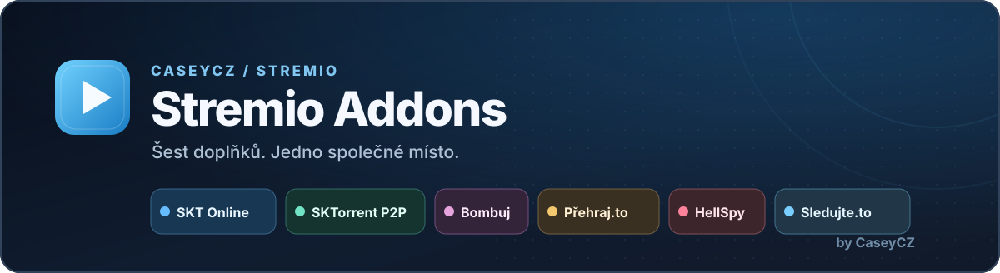

  

  

  <strong>Filmy a seriály z oblíbených českých zdrojů přímo ve Stremiu.</strong> 
  Přehledně, pohodlně a podle vlastního výběru.

  

  

## O projektu

**CaseyCZ Stremio Addons** je naše sada doplňků pro Stremio, díky které můžeš snadno vyhledávat filmy a seriály z více míst.

Každý doplněk si můžeš nainstalovat samostatně. Vyber si jen ty, které chceš používat, nebo je kombinuj podle potřeby.

## Dostupné doplňky

| Doplněk | Co nabízí | Přihlášení |
| --- | --- | --- |
| 🎬 **SKT Online** | Filmy a seriály, přímé přehrávání a dostupné titulky. | Není potřeba |
| ▶️ **Přehraj.to** | Filmy, seriály, různé dostupné verze a titulky. | Volitelné |
| 🔥 **HellSpy** | Vyhledávání filmů a seriálů, přímé přehrávání a dostupné titulky. | Není potřeba |
| 📺 **Sledujte.to** | Filmy a seriály s přehráváním prostřednictvím vlastního účtu. | Vlastní účet |
| 🍿 **Bombuj** | Filmy, seriály a přehledný výběr dostupného přehrávání. | Není potřeba |
| 🧲 **SKTorrent P2P** | Další možnosti přehrávání filmů a seriálů. | Vlastní účet SKTorrent |

**Účet Premium není podmínkou instalace doplňků Přehraj.to ani Sledujte.to.** Některé soubory nebo způsoby přehrávání ale mohou být omezené pravidly jednotlivých služeb.

## Co doplňky umí

- 🎬 **Filmy a seriály** – výběr z více zdrojů na jednom místě.
- 🔎 **Pohodlné vyhledávání** – nabídka dostupných verzí pro vybraný titul.
- 📺 **Výběr kvality** – pokud je u videa více možností.
- 🇨🇿 🇸🇰 **Jazyky** – přehledné informace o češtině, slovenštině a dalších jazycích, pokud jsou dostupné.
- 💬 **Titulky** – snadný výběr dostupných titulků.
- 🧩 **Samostatné doplňky** – nainstaluj si pouze to, co používáš.

## Jak nainstalovat

1. Otevři **[konfigurační stránku CaseyCZ Stremio Addons](https://130.61.49.108/stremio-addons/configure)**.
2. Vyber doplněk, který chceš přidat.
3. Pokud je potřeba účet, vyplň přihlašovací údaje. U Přehraj.to můžeš pokračovat i bez nich.
4. Klikni na **Instalovat** a potvrď přidání doplňku ve Stremiu.

Hotovo! Jednotlivé doplňky můžeš kdykoli přidat nebo odebrat.

## Volitelné propojení se Sosáčem

Používáš také **Sosáč**? V nastavení si můžeš zapnout propojení s vlastním účtem, aby se u podporovaných filmů a seriálů zobrazovaly další dostupné možnosti přehrávání.

Propojení je dobrovolné. Doplňky můžeš používat i samostatně.

## Kvalita, jazyky a titulky

Všechny doplňky používají stejný základní formát jako Sosáč: nejprve **🎧 zvuk**, potom **💬 titulky** a **🎬 kvalita**. Pokud známe původní označení souboru, následuje **🎞 název vydání**. Příklad videa označeného českým dabingem a kvalitou 1080p s dostupnými anglickými titulky:

**Přehraj.to • 1080p**  
🎧 🇨🇿 CZ  
💬 🇬🇧 EN  
🎬 1080p  
🎞 Ukázkový film 2026 1080p CZ dabing

- **🎧 Zvuk:** jazyk uvádíme pouze tehdy, když ho lze rozpoznat z označení videa (například „CZ dabing“). Samotné „CZ titulky“ český dabing nepotvrzují.
- **💬 Titulky:** zobrazujeme jazyky dostupných titulkových stop, pokud je zdroj poskytuje.
- **🎬 Kvalita:** u Přehraj.to jde o údaj odvozený z názvu vydání, nikoli o nezávisle změřené rozlišení.
- **🎞 Název:** původní označení videa, pouze pokud je dostupné.

U **SKTorrent P2P** zůstávají navíc údaje o seederech a velikosti. U **Bombuj** zůstává viditelný název původního přehrávače. Titulkové stopy zůstávají ve Stremiu samostatné.

Neznámé informace se mohou zobrazit jako „Neuvedeno“, „Kvalita neuvedena“ nebo „Bez titulků“ (pokud zdroj žádné titulkové stopy neposkytl). Konkrétní podoba výpisu se mezi doplňky liší.

## Soukromí a bezpečnost

Přihlašovací údaje vyplňuj pouze do konfigurace doplňku. **Instalační odkazy vytvořené s účtem nikomu neposílej**, protože mohou obsahovat chráněné údaje potřebné k přihlášení.

Volitelnou analytiku na konfigurační stránce zapínáme pouze s tvým souhlasem. Nastavení cookies můžeš kdykoli změnit.

CaseyCZ Stremio Addons je **nezávislý komunitní projekt**. Není oficiálně propojen s provozovateli podporovaných služeb ani se Stremiem. Samotná videa nehostujeme; jejich dostupnost a možnosti přehrávání závisí na příslušné službě.

## Podpora projektu

Pokud ti naše doplňky pomáhají a chceš podpořit jejich další vývoj, můžeš využít Buy Me a Coffee. ❤️

  

   
  Naskenuj QR kód nebo klikni na tlačítko.

  

