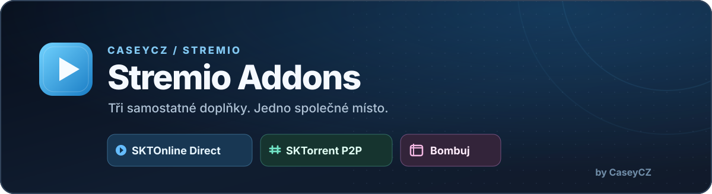

  

  

  Neoficiální komunitní sada doplňků pro <strong>Stremio</strong>: <strong>SKTOnline Direct</strong>, <strong>SKTorrent P2P</strong>, <strong>Bombuj</strong> a <strong>Přehraj.to Direct</strong>.

  

  
  

## O projektu

**CaseyCZ Stremio Addons** nabízí na jedné konfigurační stránce čtyři odděleně instalovatelné doplňky. Každý má vlastní manifest a funguje samostatně.

| Doplněk | Zdroje | Přihlášení |
| --- | --- | --- |
| 🎬 **SKTOnline Direct** | Přímé streamy a dostupné titulky | Nepotřebuje |
| 🧲 **SKTorrent P2P** | Torrentové zdroje se seedery a kvalitou | Vlastní účet SKTorrent |
| 🍿 **Bombuj** | Filmy, seriály, přehrávače a Cinemeta | Nepotřebuje |
| ▶ **Přehraj.to Direct** | Přímá MP4 CDN videa a titulky dle dostupnosti | Nepotřebuje |

## Hlavní funkce

- 🎬 přímé video zdroje SKTOnline
- 🧲 samostatně instalovatelné P2P torrenty SKTorrent
- 🍿 samostatný Bombuj s filmovými a seriálovými katalogy
- ▶ samostatné Přehraj.to přes česká vyhledávací a resolver API
- 💬 dostupné titulky a rozpoznaný jazyk přehrávání
- 🔗 kompatibilita titulů přes IMDb/Cinemeta i vlastní ID Bombuj
- ⚡ rychlejší opakované vyhledávání díky dočasné cache
- 📱 podpora běžných Stremio klientů podle možností jejich přehrávačů

## Společný repozitář

Všechny čtyři doplňky i konfigurátor jsou spravovány v [CaseyCZ/stremio.addons](https://github.com/CaseyCZ/stremio.addons). Bombuj se spouští z `providers/bombuj/`. Pracovní adresář na Oracle je `/home/ubuntu/stremio.addons`. Veřejné instalační cesty `/stremio-sktonline/` a `/stremio-bombuj/` zůstávají kvůli kompatibilitě nezměněné.

## Instalace doplňků

**Společná konfigurace** slouží k instalaci všech tří doplňků:

1. **SKTOnline Direct** – vybereš instalaci bez přihlášení.
2. **SKTorrent P2P** – zadáš svůj SKTorrent účet a po ověření získáš šifrovaný instalační odkaz.
3. **Bombuj** – nainstaluješ bez přihlášení; případně můžeš zapnout volitelné propojení se Sosáčem.
4. **Přehraj.to Direct** – nainstaluješ bez přihlášení. Manifest má samostatnou cestu `/stremio-sktonline/prehrajto/manifest.json`.

Samostatné tlačítko **Bombuj – Přímá instalace** nad tímto textem vede rovnou na jeho veřejný manifest. Doplňky můžeš instalovat nezávisle v libovolné kombinaci.

## Volitelné propojení se Sosáčem

Můžeš zadat své údaje Sosáč pro rozpoznání položek z jeho katalogu. Každý doplněk pak nabídne své vlastní dostupné streamy také u podporovaných titulů Sosáč.

**Samotný Sosáč ani jeho repozitář neupravujeme.** Bez přihlašovacích údajů k Sosáči všechny tři doplňky nadále fungují se svými podporovanými tituly.

Bombuj používá při volitelném propojení šifrovaný instalační manifest; bez propojení zůstává na svém samostatném serverovém procesu.

## Přehraj.to Direct – technické poznámky

Nový nezávislý zdroj funguje pouze pro IMDb/Cinemeta ID (`tt...` a u seriálů `tt...:sezóna:epizoda`). Před resolvem kontroluje úplný název, rok u filmů a přesnou epizodu u seriálů. Vyhledává přes externí službu Blaniok a obnovuje podepsanou MP4 URL přes `ceskarepublika.wiki/api/movies/video-url`. Obě služby jsou třetí strany; nemají garantovanou dostupnost ani veřejné SLA.

MP4 i VTT se předávají jako přímé adresy CDN, **neprocházejí přes Oracle**. Titulky se připojují přímo ke konkrétnímu streamu. Jazyky `cze/slo/eng/ng1/ng2` se převádějí na ISO 639-2 `ces/slk/eng`. Není-li kvalita explicitně ověřená API, stream se **neoznačuje 1080p jen podle názvu souboru**. Externí služba může vrátit jen jednu MP4, ačkoli název uploadu naznačuje vyšší kvalitu.

Přehraj.to není zahrnuto do stávajících šifrovaných konfigurací SKTOnline, SKTorrent či Bombuj. Jeho instalace nemění žádné již nainstalované doplňky.

## Soukromí a přehrávání

Údaje k SKTorrentu a volitelně k Sosáči se ukládají do šifrované instalační konfigurace. **Instalační odkazy obsahující konfiguraci nesdílej veřejně.**

Videa z SKTOnline a Bombuj neprocházejí serverem doplňků. Torrenty jsou samostatné P2P zdroje. Některé webové přehrávače Bombuj nemusí být kompatibilní se všemi Stremio klienty.

## Důležité

Projekt je neoficiální komunitní doplněk a není oficiálně spojen se službami Stremio, SKTOnline, SKTorrent, Bombuj ani Sosáč. Dostupnost zdrojů závisí na původních poskytovatelích.

## Podpora

  

   
  Naskenuj QR kód nebo klikni na tlačítko.

  

